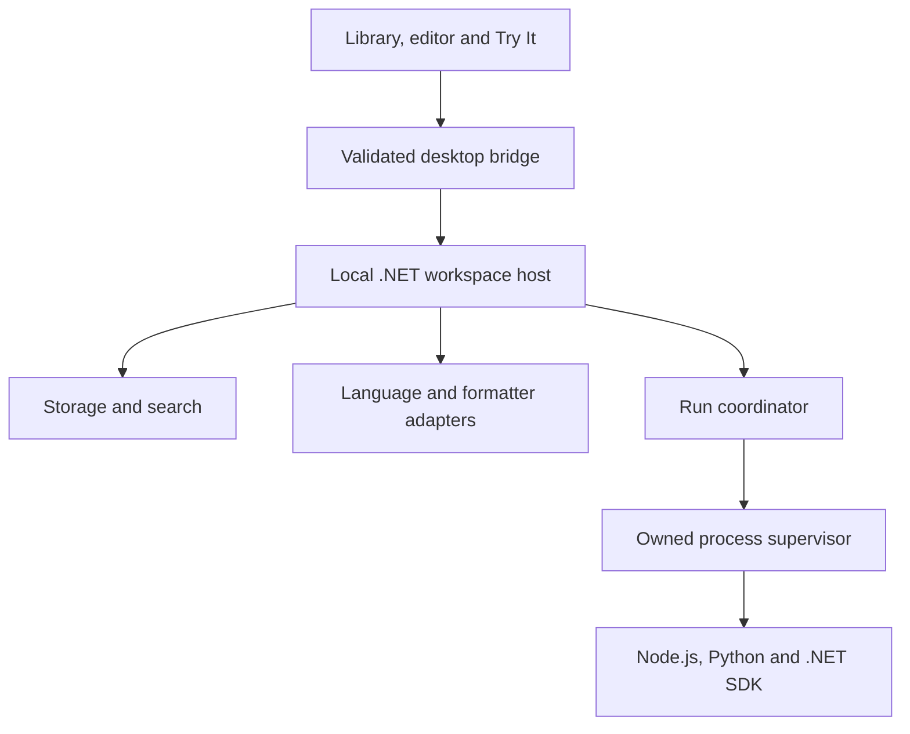
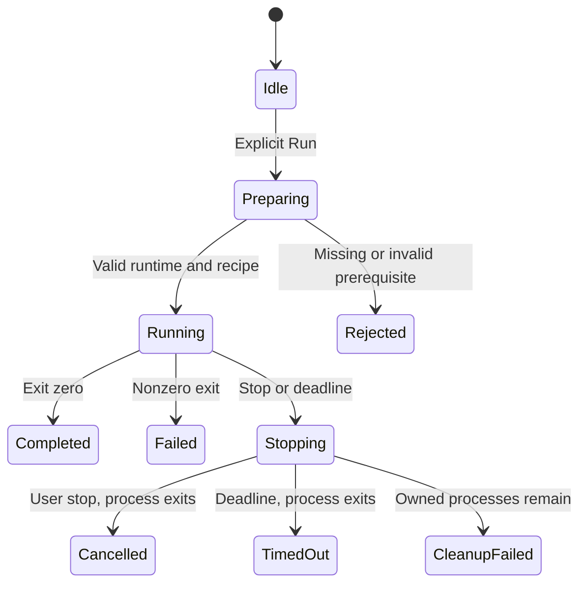

# ASTELVO by Sun — Architecture roadmap and milestones

**Organize. Script. Explore.**  
SUN-002 · `Sun.Workspace` · Updated 2026-11-12 · Architecture v0.1 (proposed)

This revision supersedes the database-first kickoff. Name, tagline and product direction are approved. Architecture choices are recommendations to validate in M0; no application implementation exists yet. SQL Server/PostgreSQL connections and Kubernetes forwarding move to future extensions.

## Product and v1 scope

A local code organizer and interactive scripting workspace: find reusable code, edit comfortably and try it without a full IDE project. One local user, offline organization/editing, installed local runtimes, Windows first with portable contracts. No cloud service or ORYVA deployment required for v1.

Include workspaces, nested folders, tags, favourites, smart collections, indexed search, tabbed editing, formatting, recovery, JavaScript/Python/C# runners, saved inputs/arguments, named examples, import/export and backup/restore. Separate editing, formatting and execution capability indicators: highlighting a language does not mean its formatter or runtime is installed.

Defer debugger, terminal/TTY, persistent REPL state, arbitrary selection execution, team sync, AI execution, public plugin marketplace, automatic dependency installation, SQL connections and Kubernetes.

## Architecture

Recommend a modular desktop app, not microservices: Electron + React/TypeScript + Monaco, backed by a local .NET 10 workspace worker. Validate Electron startup, memory, packaged Monaco workers, IPC and worker packaging before accepting the shell ADR. A self-contained workspace worker avoids requiring the .NET SDK merely to organize scripts; C# execution requires the SDK separately.

All components above are planned. Script content is data in the renderer; never evaluate it inside Electron renderer, preload or main.

| Boundary | Ownership |
|---|---|
| Desktop shell/UI | Windows, app lifecycle, explorer, editor models, recipe forms and output panes |
| Application core | Workspace commands, revisions, run coordination and domain rules |
| Storage | Source files, portable manifests, recovery journal, SQLite catalog/search and migrations |
| Language services | Identification, supported editor features, formatter discovery and formatting |
| Runner adapters | Runtime resolution, execution plan and diagnostics for each language |
| Process supervisor | Structured launch arguments, environment, stdin/output, limits, cancellation and cleanup |

Use internal `ILanguageService`, `IFormatter`, `IRuntimeResolver`, `IScriptRunner`, `IProcessSupervisor` and `IWorkspaceStore` contracts. Validate them with real adapters before publishing packages or loading external plugins.

Electron main launches the worker through owned stdio pipes. Use a versioned framed protocol, request/run IDs, cancellation, maximum message sizes and output backpressure. Worker stdout is protocol only; diagnostics use stderr. User-code output is captured and wrapped as events. Use a narrow preload bridge, IPC sender validation, renderer sandboxing, context isolation, disabled renderer Node integration and restricted navigation. No local HTTP execution endpoint is needed.

## Organization and persistence

| Concept | Meaning |
|---|---|
| Workspace | Portable library root |
| Folder | Script's physical home; nested and movable |
| Script | Stable ID, relative source path, title, description, language and revision hash |
| Tag | Classification across folders |
| Smart collection | Saved filters over language, tags, folder, favourite state and recency |
| Editor session | Buffer, disk revision, dirty state and recovery snapshot |
| Run recipe | Runner/runtime, arguments, stdin, working directory and timeout |
| Example | Named input and optional expected output |
| Run record | Exact script/recipe snapshot, runtime/version, status, timing and exit code |

Profiles no longer own scripts. Future database connections become optional execution targets attached to recipes. A script may appear in several smart collections without duplicate files.

Source text lives in ordinary files. A versioned portable manifest is authoritative for organization, IDs, recipes and collections. SQLite contains a rebuildable catalog/full-text index plus local run/history data; it must not become a conflicting authority for portable metadata. Secrets never enter manifests.

Journal source/manifest changes, use hashes and atomic replacement where available, and rebuild indexes after recovery. Multiple files are not one filesystem transaction. Enforce one writer per workspace. External edits must not overwrite dirty buffers; external rename ambiguity may need reconciliation. Protect workspace boundaries against traversal/symlink escape and unsafe archive extraction. Imports never execute code or hooks. Verify backups by restoring source and manifests into a fresh workspace.

## Language support

| Language | Editor baseline | Formatter proposal | Try It model |
|---|---|---|---|
| JavaScript | Monaco language service | Prettier | External Node.js; explicit script/module mode |
| Python | Highlighting; advanced completion later | Ruff formatter | Selected interpreter, unbuffered output |
| C# | Highlighting and run compiler diagnostics; rich completion later | Roslyn adapter | .NET 10 file-based app, top-level statements |
| Other code/text | Available Monaco grammars | Only when an adapter exists | Disabled until a runner exists |

Pin and license-review formatter dependencies during implementation. Missing tools must not block editing. Format is explicit, undoable and preserves the buffer on failure. Syntax highlighting does not automatically provide full language intelligence or formatting.

C# is not a `.csx` REPL. Evaluate `dotnet run --file` in a controlled scratch location, with explicit restore/build behaviour and no inherited unrelated parent MSBuild files. Package directives can trigger downloads/build-time code; initial examples use standard libraries. Node/Python execute outside Electron's privileged runtime. Detect installed runtimes, record executable/version and allow explicit path selection; no automatic global installs or PATH changes.

## Try It lifecycle and trust boundary

- Execute the whole current buffer snapshot, saved or unsaved; retain its hash and recipe. Edits during a run do not change that run.
- Fresh process per run; no hidden state from prior runs. Start with one active run per tab and a small global concurrency limit.
- Capture stdout/stderr independently with incremental decoding, bounded buffers and explicit truncation. Preserve ordering within each stream; do not promise a total ordering across OS streams.
- Saved stdin and structured argument arrays are first-class. Close stdin after supplied input. TTY/interactive prompts are deferred.
- Working directory is visible and explicit, defaulting to scratch. Workspace fixtures require a selected directory. Document snapshot filenames/relative-import limits; full multi-file projects are deferred.
- Proposed default wall timeout: 30 seconds, configurable. Stop the entire owned process tree and verify exit; evaluate Windows Job Objects. Report cleanup failure honestly.
- Separate processes and timeouts improve reliability, not security isolation. Local scripts run with the user's OS permissions and can access files/network. Renderer sandboxing does not sandbox user scripts.
- No automatic execution on open/import/restore/format; no automatic failed-run retries or dependency installs. Render output as text, not executable HTML or terminal control commands.
- Output persistence is opt-in with retention controls. Minimize inherited environment secrets; recipes store secret references rather than secret values if that feature is added.

## Milestones and exit gates

States: Planned → In progress → PR open → Merged → Validated → Complete. Track Blocked separately with a named dependency. Completed items require evidence links; passing CI does not imply packaged/manual checks passed.

| Milestone | Deliverable | Exit gate | State |
|---|---|---|---|
| M0 | Template, governance, architecture ADRs, shell/IPC spike and CI | Protected repo; packaged editor reaches worker; enforcement evidence recorded | In progress — repository created; architecture PR being prepared |
| M1 | Organizer and durable workspace | Folders/tags/collections/search persist; import/export, recovery and restore pass | Planned |
| M2 | Everyday editor | Tabs, formatting, search/replace, recovery and external-edit conflicts work | Planned |
| M3 | JavaScript/Python Try It | Snapshot execution, stdin, stop/timeout/tree cleanup and bounded output pass | Planned |
| M4 | C# and reusable recipes | Compile/run diagnostics, saved inputs/arguments and examples work | Planned |
| M5 | Desktop v1 packaging and acceptance | Clean-machine install, restore, accessibility and documented limitations pass | Planned |
| M6 | Provider expansion | One real additional target validates extension contracts | Future, outside v1 |

### M0 — Foundation

- [x] Product name, ID and revised tagline approved.
- [x] Inspect SUN template/provisioner and ORYVA milestone format; draft revised baseline.
- [x] Generate product repository from template: `sunstriker2009/sun-astelvo`, public, `main`. Template files inspected; branch reports protected.
- [ ] Discover exact template CI checks; plan/apply/verify governance and test failed-CI blocking.
- [ ] Enforce sensitive-change review and real CODEOWNERS separately from baseline bootstrap.
- [ ] ADR-001 shell/IPC; ADR-002 storage/recovery; ADR-003 local execution boundary.
- [ ] .NET 10 solution, UI skeleton, dependency locks, worker lifecycle and packaged Monaco spike.
- [ ] Add short backend/frontend CI with stable check names and concurrency cancellation.

### M1 — Organizer

- [ ] Workspace create/open, manifest schema, writer lease and recoverable writes.
- [ ] Script/folder CRUD, move, duplicate, delete/restore and stable IDs.
- [ ] Tags, favourites, smart collection filters and indexed search.
- [ ] Safe import/export, index rebuild and backup/restore.
- [ ] Useful standard-library examples requiring no packages/network.

### M2 — Editor

- [ ] Monaco tabs, language selection, shortcuts, find/replace and command palette.
- [ ] Three formatter adapters with undo and failure handling.
- [ ] Autosave/recovery and external-change conflict handling.
- [ ] Separate edit/format/run capabilities and runtime setup view.

### M3 — JavaScript/Python

- [ ] Runtime discovery and explicit executable selection.
- [ ] Shared supervisor/protocol, cancellation, output bounds and cleanup.
- [ ] Node/Python adapters, stdin, arguments and run revision identity.
- [ ] Missing-runtime guidance; errors, output, duration and exit-code display.
- [ ] Infinite loop, child-process tree, output flood and app-shutdown acceptance.

### M4 — C# and recipes

- [ ] SDK discovery, controlled file-based compile/run and artifact cleanup.
- [ ] Diagnostics/source mapping and explicit restore/dependency behaviour.
- [ ] Saved recipes and named inputs with optional expected-output comparison.
- [ ] Standard-library examples pass the shared runner contract across all three languages.

### M5 — Release acceptance

- [ ] Clean-machine installer/start/uninstall with runtimes present and missing.
- [ ] Keyboard/focus accessibility, themes and readable results.
- [ ] Forced shutdown recovery, import conflicts and fresh-workspace restore.
- [ ] Proposed search target: 10,000 metadata records; warm p95 under 300 ms on a documented Windows reference machine. Agree measurement protocol before acceptance.
- [ ] Set startup/memory budgets from M0 measurements; verify output stress and UI responsiveness.
- [ ] Review IPC, imports, environment handling and supervision; document limits.
- [ ] Dependency/license review, guide, release notes and SemVer.
- [ ] Decide installer signing/update strategy. Publishing is a deliberate release step.

v1 acceptance: import JS/Python/C#, organize via folders and overlapping tags, save a collection, search/edit/format with undo, run saved input, stop an infinite loop without closing the app, recover an unsaved buffer and export/restore the workspace on another supported installation.

## Repository provisioning: reuse existing SUN assets

Inspected 2026-11-12: `sunstriker2009/sun-repo-template` is an enabled template; `sun-repo-bootstrap` operates on existing repos. It does not create repos. Template generation does not copy rulesets, secrets, environment approvals or CI history.

1. Completed: `sunstriker2009/sun-astelvo` exists with template files, public visibility and `main`. Retain the selected visibility. The following is the reference adoption procedure; audit existing protections before any further apply.
2. Wait for `repository-validation` on main; open the architecture documentation PR so PR-only `conventional-title` runs. Keep it open for bootstrap discovery.
3. Scope existing `SUN_REPO_ADMIN_TOKEN` to the new target and verify provisioning environments. Never paste tokens into chat or commits.
4. Use the existing workflow with the exact inputs below, plan → apply → verify. Apply may wait for the existing administration environment reviewer.

| Workflow input | Value |
|---|---|
| Workflow/ref | `sun-repo-bootstrap/.github/workflows/provision.yml`, `main` |
| repository | `sunstriker2009/sun-astelvo` |
| operation | `plan`, then `apply`, then `verify` |
| required_checks | `repository-validation,conventional-title` after checking actual emitted names |
| confirm_repository | `sunstriker2009/sun-astelvo` for apply |

5. Verify squash only, auto-merge/delete branches, PR protection, strict checks, resolved conversations and no routine bypass. Use a failing PR to verify merge blocking before repairing it.
6. Add real CODEOWNERS and review enforcement for execution/IPC/security changes. Current bootstrap creates zero mandatory approvals; its verifier also expects zero approvals. Stronger review settings need a manual audit or separately reviewed provisioner enhancement, never weakening protection to satisfy the verifier.
7. If account-plan limits prevent private-repo enforcement, mark governance blocked; do not silently change visibility.
8. Add product CI by PR, observe exact names and update protection through a reviewed procedure. A second bootstrap apply is not an update mechanism: it refuses existing named rulesets.

Current adoption evidence: the repository exists, is public, uses `main`, and contains SUN template files. GitHub reports main as protected; squash-only merging and auto-merge are enabled. Exact ruleset membership, sensitive-change review enforcement and failed-CI blocking still need verification. Audit before rerunning bootstrap apply, which refuses existing named rulesets. Creation is no longer a blocker. No new provisioning/settings operation was performed in this update.

## Repository documents and PR batches

| Planned path | Purpose |
|---|---|
| `README.md` | Product, setup and limitations |
| `docs/architecture/OVERVIEW.md` | Components and process boundaries |
| `docs/architecture/EXECUTION.md` | Runners, formatters and lifecycle |
| `docs/architecture/STORAGE.md` | Sources of truth, recovery and portability |
| `docs/roadmap/MILESTONES.md` | M0–M6 with evidence links |
| `docs/roadmap/MASTER-CHECKLIST.md` | Detailed v1 acceptance |
| `docs/adr/0001-desktop-host.md` | Shell/IPC decision and spike evidence |
| `docs/operations/REPOSITORY-ADOPTION.md` | Actual governance enforcement evidence |

Coherent batches: architecture/docs → shell/host foundation → organizer → editor → JS/Python → C#/recipes → packaging/hardening. Keep application code out of the SUN brand repository.

CI budget: preserve template/title validation, use short Linux .NET/UI checks, cancel superseded runs and avoid duplicate full push/PR builds. Run Windows packaging/runtime gates at milestones initially; measure minutes before adding schedules/matrices. Batch fixes before rerunning; do not drop required checks to save quota.

## Current status and reporting

Registration PR #6 is merged. Revised scope/tagline remains in [SUN ecosystem PR #7](https://github.com/sunstriker2009/sun-ecosystem/pull/7), open and unmerged at inspection. The product repository is created and M0 is in progress. Architecture documents are being added by PR. M1–M5 implementation is planned; no application builds, runner tests or packaged desktop acceptance have run. Future reports show current milestone, merged evidence, open PR/check state, next deliverable and specific blockers.

## Sources

- [SUN template](https://github.com/sunstriker2009/sun-repo-template) and [setup checklist](https://github.com/sunstriker2009/sun-repo-template/blob/main/docs/REPOSITORY-SETUP.md)
- [Provisioning workflow](https://github.com/sunstriker2009/sun-repo-bootstrap/actions/workflows/provision.yml)
- [SUN governance](https://github.com/sunstriker2009/sun-ecosystem/blob/main/docs/governance/GIT-WORKFLOW.md)
- [ORYVA milestones](https://github.com/sunstriker2009/sun-oryva/blob/main/docs/roadmap/MILESTONES.md)
- [Electron security](https://www.electronjs.org/docs/latest/tutorial/security/) and [context isolation](https://www.electronjs.org/docs/latest/tutorial/context-isolation/)
- [Monaco](https://github.com/microsoft/monaco-editor)
- [.NET file-based apps](https://learn.microsoft.com/en-us/dotnet/core/sdk/file-based-apps)

Validate dependency versions, formatter packaging and platform behaviour during implementation; this roadmap does not claim integrations already work.