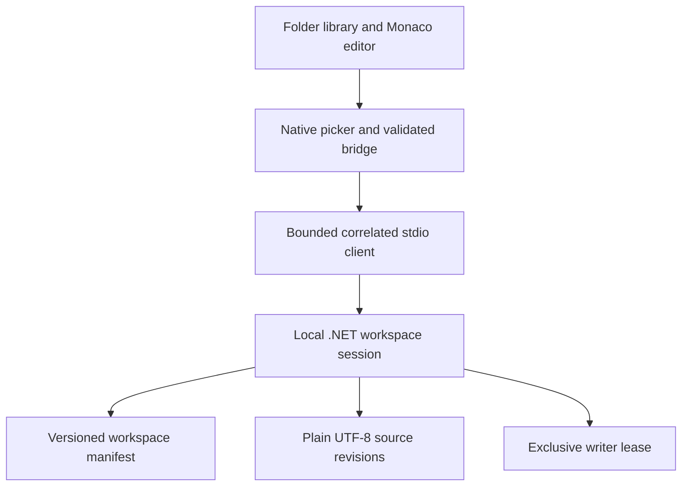

# ASTELVO architecture overview

The merged M0 foundation provides Electron/React/Monaco, an owned .NET 10 host and framed stdio. Automated Windows portable acceptance [passed](https://github.com/sunstriker2009/sun-astelvo/actions/runs/43609933010). Interactive clean-machine and governance follow-ups remain open.

The first M1 slice adds native workspace selection, plain source revisions, a versioned manifest, exclusive writer lease and optimistic conflict checks. Save is manual; the editor holds one script at a time. See [Workspace format v1](WORKSPACE-FORMAT.md).

The manifest references staged source revisions; replacing the manifest commits the operation. A failed/conflicting save keeps the editor buffer and avoids overwriting the external source.

Search/SQLite indexing, tags/collections, import/export and backup/restore remain M1 work. Multi-tab editing, autosave/recovery and formatting remain M2. Execution adapters, runtime supervision and cancellation remain M3/M4. No script content is executed by the workspace host.

Renderer isolation does not sandbox future user scripts; local execution will use user OS permissions. Database execution and Kubernetes are outside v1. [Canonical roadmap](../ASTELVO%20Roadmap.md).
