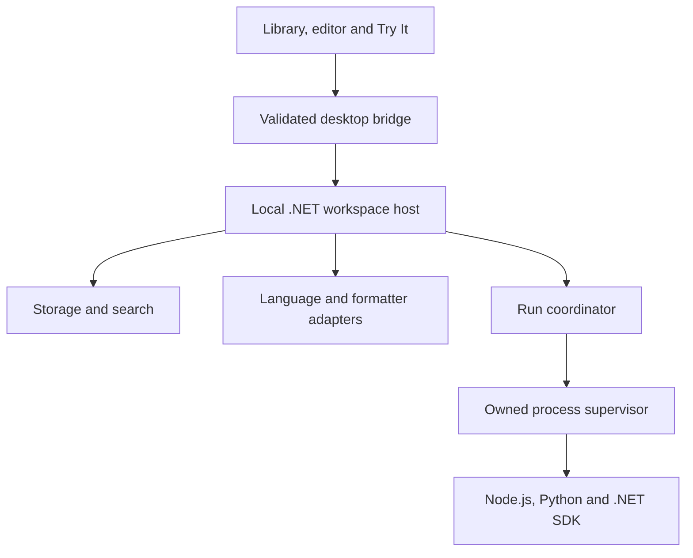

# ASTELVO architecture overview

Status: proposed, subject to M0 validation. [Canonical roadmap](../ASTELVO%20Roadmap.md#architecture).

Proposed stack: Electron, React/TypeScript and Monaco with an owned .NET 10 worker; portable files/manifests and SQLite indexing. JavaScript, Python and C# run through separate local processes and adapters.

## Decisions to validate

- ADR-001: shell and framed stdio IPC; packaged Monaco workers and worker lifecycle.
- ADR-002: manifest authority, journalled file changes, rebuildable indexes and conflicts.
- ADR-003: local execution trust boundary, process-tree cleanup and bounded output.

Renderer isolation does not sandbox user scripts. Local execution uses user OS permissions. Database execution and Kubernetes are outside v1.
