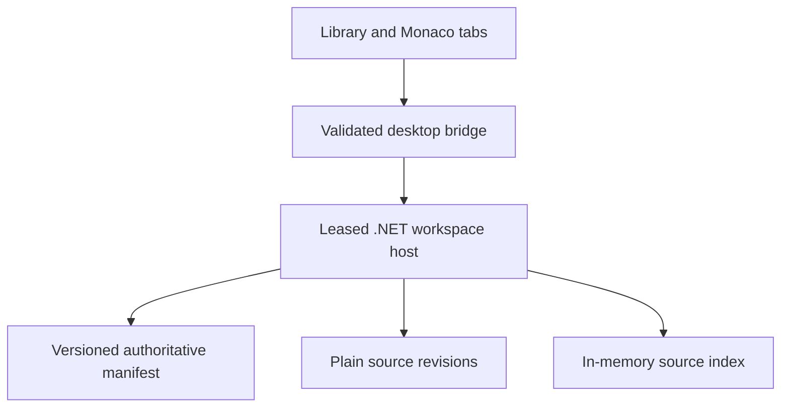

# ASTELVO architecture overview

[Continuation and unfinished work](../operations/CONTINUATION.md) · [Architecture roadmap](../ASTELVO%20Roadmap.md)

The implemented desktop uses Electron/React/Monaco and an owned .NET 10 host with framed stdio. A narrow native picker/command bridge separates renderer code from workspace operations. Portable staging includes the workspace host; organizing/editing does not require a global .NET runtime.

The manifest references staged source revisions; replacing the manifest commits the operation. Stable identities survive moves and recoverable deletion/restoration. Tags, favourites, saved metadata collections, loose-file imports and verified committed-state archives are implemented. Source search is currently a bounded session index; a persistent rebuildable SQLite catalog remains unfinished. See [workspace format](WORKSPACE-FORMAT.md) for current schemas, limits and recovery rules.

Monaco models retain independent tab drafts and undo state. Save explicitly commits canonical data; durable checkpoints and opt-in automatic checkpoints recover drafts separately. Archives exclude those checkpoints. Hash checks and explicit reload/recovery prevent silent external-change overwrites.

Formatting is implemented for JavaScript (Prettier worker), Python (Ruff WASM worker) and C# (isolated Roslyn formatter process). Format is undoable and cannot run scripts. See ADRs [010](../adr/0010-javascript-formatting.md), [011](../adr/0011-python-formatting.md) and [012](../adr/0012-csharp-formatting.md).

All script runners are planned M3/M4 work under [ADR-003](../adr/0003-local-execution.md): explicit runtime selection, immutable run snapshots, owned external processes, bounded output, cancellation/deadlines and verified tree cleanup. Formatter supervision is not a completed runner.

Windows-first acceptance remains distinct from Linux checks. The older [automated Windows foundation run](https://github.com/sunstriker2009/sun-workbench/actions/runs/43609933010) does not establish acceptance of current features. Clean-machine, accessibility, shutdown/power-loss, performance, governance and final product gates remain tracked in the checklist.

Local script execution will use the user's OS permissions; renderer isolation does not sandbox scripts. SQL/database providers and Kubernetes remain outside v1.
